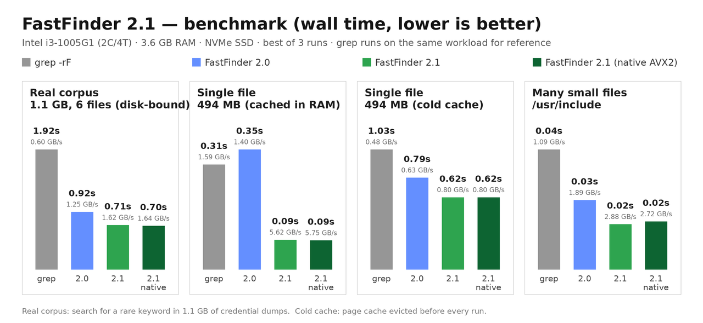

# FastFinder 🚀


**FastFinder** is a blazing-fast, cross-platform command-line tool that recursively searches text files for a keyword and saves every matching line to an output file.

Built in C with a producer/consumer thread pool, zero-copy memory mapping and a fused SIMD scanning engine, it **saturates disk and memory throughput** while keeping memory usage flat.

**Latest benchmark** (real 1.1 GB corpus, 4 threads): **0.70 s** vs **1.92 s** for `grep -rF` — and **0.09 s** for a 494 MB file already in RAM (~5.6 GB/s). See [benchmarks](#performance-).

Works on **Windows** and **Linux** from the same single source file.

---

## Features 🌟

- **Cross-platform** — one `fastfinder.c` for Windows and Linux, no external dependencies.
- **Adaptive zero-copy I/O** — memory-mapped scanning (`mmap` / `MapViewOfFile`) when the data is in the page cache, plain large sequential reads when it still has to come from disk. The engine samples page residency (`mincore` / `QueryWorkingSetEx`) and picks the faster path per file range. Zero-copy is up to **~2× faster** on cached data; streaming reads are **~15–20% faster** on cold data.
- **Big files scan in parallel** — files larger than 8 MiB are split into line-aligned segments and distributed across workers, so a single 50 GB dump uses every core.
- **Fused SIMD matching engine** — one pass that finds keyword candidates (first two keyword bytes compared vector-wide) and counts lines (`popcount` of the newline mask). SSE2 baseline plus **runtime-dispatched AVX2**: the portable build automatically uses AVX2 on any modern x86-64 CPU, no special flags needed.
- **Multi-threaded pipeline** — directory tree walking and file scanning run in parallel; one worker thread per CPU core by default.
- **Bounded memory** — a 4096-unit queue with backpressure means RAM stays constant no matter how many files exist. Private (anonymous) memory while scanning is **~16 MB** with 4 workers; mapped file pages are clean and reclaimable by the OS at any time.
- **Batched output** — matches are buffered per thread and flushed with a single lock; the output file is opened once and never locked per line.
- **Correct on the edges** — lines split across buffer/segment boundaries, files without a trailing newline, CRLF files, embedded NUL bytes and giant single-line files are all handled. Match sets verified byte-for-byte against `grep -rF`.
- **Never scans its own output file** — even when the output is written inside the scanned tree (checked by device+inode, not by path string).
- **Survives truncation** — a `SIGBUS` handler recovers cleanly if a mapped file is truncated mid-scan (e.g. an active download).
- **Handy options** — `-t` (threads), `-i` (case-insensitive), `-a` (all files, not just `.txt`), `-f` (prefix matches with the file path), `-l` (low priority), `--no-mmap`, `--no-split`.
- **Clean summary** — files/directories scanned, bytes read, throughput, lines read/matched.

---

## Building 🛠️

### Linux

```bash
make            # or:
gcc -O3 -std=c11 -pthread -s -o fastfinder fastfinder.c
```

The default build is portable (SSE2 baseline) and **automatically uses AVX2 at runtime** when the CPU supports it.

### Windows (mingw-w64)

```bash
make windows    # or:
x86_64-w64-mingw32-gcc -O3 -std=c11 -static -s -o fastfinder.exe fastfinder.c
```

> 32-bit Windows: use `i686-w64-mingw32-gcc` instead.

Both commands produce a single, statically linked executable. Tested with GCC 14 (`gcc-mingw-w64` 14.2, `-Wall -Wextra` clean).

**Tune for your exact CPU** (binary becomes non-portable, but faster on data in RAM):

```bash
make NATIVE=1   # adds -march=native
```

**Compile-time knobs** (optional):

| Macro | Default | Meaning |
|---|---|---|
| `-DFF_READ_BUF=N` | 4 MiB | per-worker read buffer (plain-read path) |
| `-DFF_MATCH_BUF=N` | 1 MiB | per-worker match batch |
| `-DFF_MMAP_MIN=N` | 1 MiB | smallest range worth mapping/adapting |
| `-DFF_SPLIT_MIN=N` | 8 MiB | files at least this large may be split |
| `-DFF_SEG_TARGET=N` | 16 MiB | target size of a split segment |

---

## Usage 📚

```
fastfinder [options] <file|directory> <keyword> <output>
```

| Option | Description |
|---|---|
| `-t, --threads N` | Worker threads (default: number of CPU cores, max 128) |
| `-i, --ignore-case` | Case-insensitive matching (ASCII) |
| `-a, --all-files` | Search every file (default: only `*.txt`) |
| `-f, --show-file` | Prefix every match with the file path |
| `-l, --low-priority` | Lower CPU and I/O priority (nice + ionice on Linux, background mode on Windows) |
| `--no-mmap` | Disable memory-mapped I/O (always use plain reads) |
| `--no-split` | Disable parallel splitting of big files (one worker per file) |
| `-h, --help` | Show help |
| `-v, --version` | Show version |

### Examples

```bash
# Linux
fastfinder /home/user/dumps "password" results.txt

# Windows
fastfinder "C:\Users\user\Downloads" login output.txt

# Case-insensitive, all file types, 8 threads, with file paths
fastfinder -i -a -f -t 8 /data "api_key" leaks.txt

# Stay friendly to the rest of the system (lower CPU/IO priority)
fastfinder -l -t 2 /data "password" results.txt
```

### Sample output

```
fastfinder: searching for 'password' in /home/user/dumps (8 threads)

FastFinder 2.1.0
  Root          : /home/user/dumps
  Keyword       : password
  Threads       : 8
  Engine        : AVX2 SIMD, mmap/reads, auto-split
  Directories   : 12
  Files scanned : 340
  Data read     : 1.05 GB in 0.44 s (2.36 GB/s)
  Lines read    : 13792000
  Lines matched : 13792
  Output        : results.txt
```

---

## Performance ⚡



Measured on an Intel i3-1005G1 (2 cores / 4 threads), 3.6 GB RAM, NVMe SSD, best of 3 runs, `grep` on the same workload for reference. Data: `benchmarks/results.csv`.

**Real-world corpus — 1.1 GB of credential dumps, 6 large files (data does not fit in the page cache → disk-bound):**

| Command | Wall time | Throughput | CPU time |
|---|---|---|---|
| `grep -rF -a` (reference) | 1.92 s | 0.60 GB/s | 0.93 s |
| `fastfinder 2.0 -t 4` | 0.92 s | 1.25 GB/s | 1.53 s |
| **`fastfinder -t 4`** | **0.71 s** | **1.62 GB/s** | **0.76 s** |
| `fastfinder -t 4` (native build) | 0.70 s | 1.64 GB/s | 0.74 s |

**Single 494 MB file, cached in RAM (repeated searches over the same dump):**

| Command | Wall time | Throughput |
|---|---|---|
| `grep -F -a` (reference) | 0.31 s | 1.59 GB/s |
| `fastfinder 2.0 -t 4` | 0.35 s | 1.40 GB/s |
| **`fastfinder -t 4`** | **0.09 s** | **~5.6 GB/s** |
| `fastfinder -t 1` (single core!) | 0.084 s | 5.89 GB/s |

**Single 494 MB file, cold cache (page cache evicted before every run):**

| Command | Wall time | Throughput |
|---|---|---|
| `grep -F -a` (reference) | 1.03 s | 0.48 GB/s |
| `fastfinder 2.0 -t 4` | 0.79 s | 0.63 GB/s |
| **`fastfinder -t 4`** | **0.62 s** | **0.80 GB/s** |

**Many small files (`/usr/include`, ~50 MB across thousands of files):**

| Command | Wall time | Throughput |
|---|---|---|
| `grep -rF -a` (reference) | 0.045 s | 1.09 GB/s |
| `fastfinder 2.0 -t 4` | 0.026 s | 1.89 GB/s |
| **`fastfinder -t 4`** | **0.017 s** | **2.88 GB/s** |

**Memory** while scanning the 1 GB corpus with 4 workers: **~16 MB of private (anonymous) RSS** — the same as 2.0. When the zero-copy path is active, the kernel additionally maps file pages, which show up as working-set memory but are **clean, read-only and immediately reclaimable** by the OS under pressure (they are just page-cache pages).

**Correctness:** match sets are verified byte-for-byte against `grep -rF -a` — per file on the real corpus, and on a dense keyword returning 31,100 matches (sorted-line MD5 identical). The test suite (`/tmp` local) covers 34 cases: buffer-boundary splits, 6 MB single lines, CRLF, EOF without newline, 10k-file trees, tiny-buffer builds, scalar fallback, `--no-mmap`/`--no-split` combinations.

*Your numbers will vary with hardware. On HDDs everything is disk-bound; fewer threads (`-t 2`) usually behave best. On very fast NVMe drives the adaptive read path keeps you at device speed.*

---

## How it works 🔬

```
                  +----------------------+
  directory  -->  | producer (main)      |  walks the tree iteratively (no recursion),
  tree walk       |  bounded queue 4096  |  pushes work units with backpressure
                  +----------+-----------+
                             |
             +---------------+--------------+-------- ...
             |               |              |
       +-----v-----+   +-----v-----+  +-----v-----+
       | worker 1  |   | worker 2  |  | worker N  |  one per CPU core
       +-----------+   +-----------+  +-----------+
        adaptive mmap/read, fused SIMD scan, 1 MiB match batches,
        single-lock flush; big files arrive as line-aligned segments
```

- **Producer/consumer with backpressure:** the main thread walks the tree and feeds a bounded ring buffer of work units. When the queue is full the walker blocks, so memory never grows with the number of files.
- **Adaptive I/O per range:** each range is mapped read-only and sampled with `mincore()` (Linux/BSD) or `QueryWorkingSetEx` (Windows). Resident pages → scan the mapping directly (zero copy). Non-resident → fall back to 4 MiB `read()`/`ReadFile()` streaming with OS readahead hints.
- **Intra-file parallelism:** big files are cut at line boundaries into ~16 MiB segments which are pushed as extra work units (non-blocking; if the queue is full the worker scans the segment itself — no deadlock possible).
- **Fused SIMD scan:** one pass per block counts newlines and finds candidate matches via first/second-byte compares, expands hits to full lines and emits each matched line exactly once. AVX2 is selected at startup with `__builtin_cpu_supports("avx2")`; non-x86 builds use a portable scalar fallback.
- **Skipped on purpose:** symlinks (same as `grep -r` and ripgrep defaults), FIFOs/sockets/devices, and the output file itself.
- **Statistics:** computed per thread and merged at the end — no atomics in the hot path.

---

## Tips for not stressing the system 🧘

- Use `-l / --low-priority` when you want the scan to stay in the background (lower CPU and I/O priority on both platforms).
- Default thread count equals your CPU cores. Use `-t 2` (or `-t 1`) on spinning disks, while gaming, or while compiling.
- RAM usage is fixed: `threads × 5 MiB` plus a small queue. Even 128 threads stay under ~700 MB.
- `--no-mmap` forces plain reads if you ever want to keep the working set minimal.
- Write the output to another drive if you are scanning a whole disk, so read and write bandwidth do not fight.

---

## Notes / Limitations 📎

- Matching is line-based; keywords cannot contain `\n`.
- `-i` is ASCII case-insensitive (predictable across platforms).
- On the default (mmap) path even giant single-line files are emitted whole. With `--no-mmap`, a single line larger than the 4 MiB read buffer is scanned chunk by chunk and a keyword split exactly across a 4 MiB boundary is not detected.
- Output order is non-deterministic across files/segments (workers race; use `sort` if you need a stable order).
- The mmap/read choice is made at runtime from page-cache residency; results are always identical, only speed differs. `--no-mmap` / `--no-split` exist for full control.
- Long Windows paths (`> 260` chars) are supported via the `\\?\` prefix.

---

## What's new in 2.1 🔧

- **New:** adaptive zero-copy I/O — memory-mapped scanning when data is cached, streaming reads when it is not (chosen per range from page residency).
- **New:** big files are split into line-aligned segments and scanned in parallel (one huge dump now uses all cores).
- **New:** fused SIMD engine with runtime AVX2 dispatch — the portable build auto-accelerates on modern CPUs; a scalar fallback keeps exotic platforms working.
- **New:** `-l/--low-priority`, `--no-mmap`, `--no-split` flags.
- **New:** `SIGBUS` recovery when a mapped file is truncated mid-scan.
- **Faster:** 2.1 is ~1.3× faster and ~2× more CPU-efficient than 2.0 on the 1.1 GB real corpus; up to ~4× faster on cached data.
- **Fixed:** giant (>16 MiB) single lines no longer blow up the match buffer on low-RAM machines.

## What's new in 2.0 🔧

- **Cross-platform:** Linux support (pthreads, `readdir`, raw `read()`), same feature set as Windows.
- **Fixed:** lines crossing internal read-buffer boundaries could be skipped (silent data loss).
- **Fixed:** only the first 1000 files were ever queued — everything beyond was ignored.
- **Fixed:** a last line without a trailing newline was never searched.
- **Fixed:** `strstr` stopped at NUL bytes; the search is now byte-safe.
- **New:** bounded queue with backpressure (constant memory), batched output writes, `-t` / `-i` / `-a` / `-f` options, help text, and a stats summary.
- **New:** the scanner never reads the output file it is writing, and never follows symlinks into loops.

---

## Download 💻

Pre-built binaries are published on the [Releases page](https://github.com/lalaio1/fastfinder/releases).

## License 📄

[Apache License 2.0](LICENSE)

## Creator 👤

[GitHub: lalaio1](https://github.com/lalaio1)

## Contributing 🤝

Contributions are welcome! If you have suggestions for improvements or find bugs, please open an issue or submit a pull request.

---

Thank you for using FastFinder! Happy searching! 🎉
